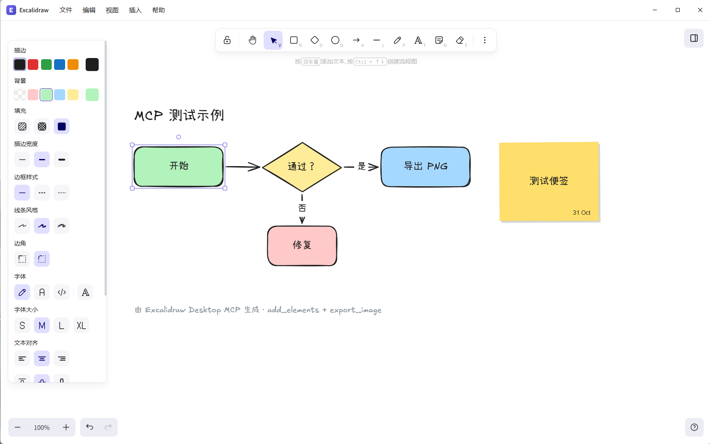
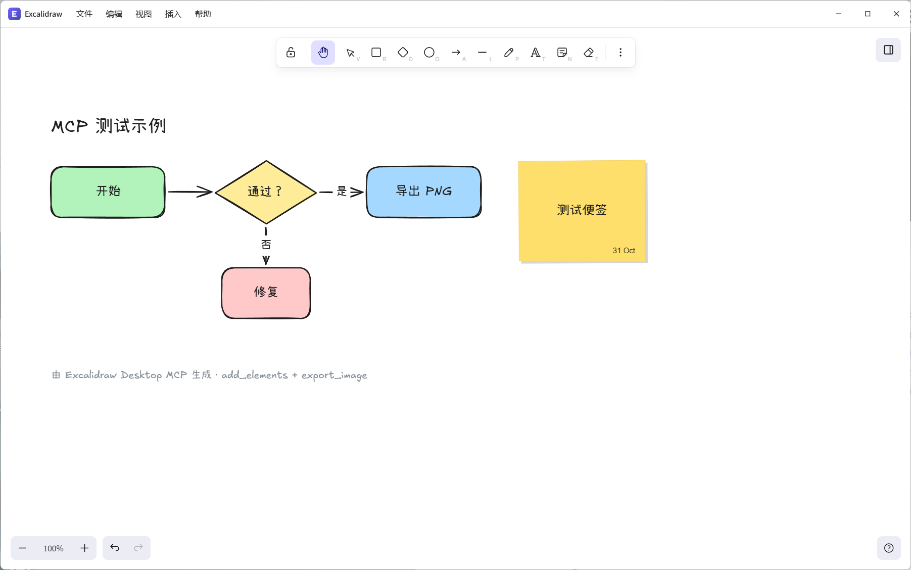

# Excalidraw Desktop

[English](./README.md) | 简体中文

基于 Electron 的纯本地、离线 Excalidraw 桌面应用。

Fork 自 [excalidraw/excalidraw](https://github.com/excalidraw/excalidraw)。

## 截图



## 功能

- 完全本地编辑，无需账号，不依赖云端
- 画布、图片和素材库全部保存在本地
- 关闭时可选择最小化到系统托盘或退出应用，并提供托盘菜单
- 自定义无边框顶栏，包含窗口控制和分类菜单
- 支持 GitHub Releases 自动更新，菜单中提供“检查更新”
- 支持 Mermaid 转 Excalidraw
- 支持文件和图片导出
- 内置 MCP 服务器，Claude Desktop、Cursor、VS Code 可直接操作当前画布
- 生产环境阻断外部网络请求

## 下载

Windows、macOS 和 Linux 安装包发布在 [GitHub Releases](https://github.com/ddz12123/excalidraw-desktop/releases)。

## 开发

```bash
pnpm install
pnpm dev
```

项目根目录的 `.npmrc` 已配置 npmmirror 作为 npm 源；安装和打包脚本也会为 Electron 和 electron-builder 二进制设置国内镜像。

如果需要临时覆盖镜像：

```bash
ELECTRON_MIRROR=https://npmmirror.com/mirrors/electron/ pnpm install
```

## 构建

```bash
pnpm build     # 使用 electron-vite 构建到 out/
pnpm build:win # 打包 Windows x64 安装包和绿色版到 release-build/
pnpm dist      # 打包当前平台到 release-build/
```

手动打包时请在对应操作系统上执行：

```bash
pnpm exec electron-builder --win --x64
pnpm exec electron-builder --mac --arm64 --x64
pnpm exec electron-builder --linux --x64
```

## Windows 产物

`pnpm build:win` 会输出两个 exe 文件：

- `Excalidraw-Setup-<version>-win-x64.exe`：NSIS 安装程序，供 `electron-updater` 自动更新使用
- `Excalidraw-Portable-<version>-win-x64.exe`：绿色版，双击直接运行，无需安装

安装程序使用辅助安装流程，而不是一键安装：

- 支持自定义安装目录
- 安装到受保护目录时允许申请管理员权限
- 自动创建桌面快捷方式和开始菜单快捷方式，名称为 `Excalidraw`
- 安装器、卸载器和快捷方式使用自有应用图标

绿色版每次运行会解压到临时目录，但画板、素材库和图片仍保存到与安装版相同的 `%APPDATA%\Excalidraw`，两者共用同一份数据。应用为单实例，安装版运行时再启动绿色版只会聚焦已有窗口。绿色版不参与自动更新。

## 发布流水线

推送以 `v` 开头的 tag（例如 `v0.1.2`）会触发 `.github/workflows/release.yml`，自动构建 Windows、macOS 和 Linux 安装包，发布到 GitHub Releases，并上传 `latest.yml`、`latest-mac.yml`、`latest-linux.yml` 供 `electron-updater` 使用。

打 tag 前请先同步修改 `package.json` 中的 `version`，确保 tag、安装包版本和更新元数据一致。

打包版本启动后会自动检查更新，也可以在菜单中手动选择“检查更新”。默认未启用代码签名；macOS 自动更新需要应用已签名并公证。

## MCP 服务器

桌面端可以把当前画布开放给 Claude Desktop、Cursor、VS Code 等 MCP 客户端：

1. 打开 `编辑 → MCP 服务器…`。
2. 启用服务器并点击“保存并应用”。
3. 复制生成的客户端配置到 MCP 客户端并重启客户端。

服务只监听 `127.0.0.1`，并且需要设置里的访问令牌。提供 `get_scene`、`add_elements`、`update_elements`、`delete_elements`、`export_image` 五个工具。生成的配置通过 `npx -y mcp-remote <endpoint> --header "Authorization:${EXCALIDRAW_MCP_TOKEN}"` 连接（令牌以环境变量形式写在配置里，不会出现在命令行上），兼容只支持 stdio 的客户端；支持 Streamable HTTP 的客户端可以直接使用 Endpoint URL 并携带 `Authorization: Bearer <token>` 请求头。设置保存在应用用户数据目录下的 `mcp-server.json`。使用 `npx` 的机器需要安装 Node.js。



项目内提供了可直接使用的技能：[`skills/excalidraw-desktop-mcp/SKILL.md`](./skills/excalidraw-desktop-mcp/SKILL.md)，需要时复制到对应 agent 的技能/规则目录即可。

## 检查

```bash
pnpm test:typecheck
pnpm test:code
pnpm test:other
```

## 目录结构

- `src/main` - Electron 主进程、窗口、离线协议和自动更新
- `src/main/mcp` - 本地 MCP 服务器、设置存储和渲染层桥接
- `src/preload` - 最小化隔离预加载桥接
- `excalidraw-app` - 渲染进程入口和应用 UI
- `excalidraw-app/mcp` - 渲染层 MCP 工具实现
- `packages/*` - 内部编辑器源码包，不再对外发布

## 许可证

MIT，详见 [LICENSE](./LICENSE)。上游版权归 Excalidraw 作者所有。
